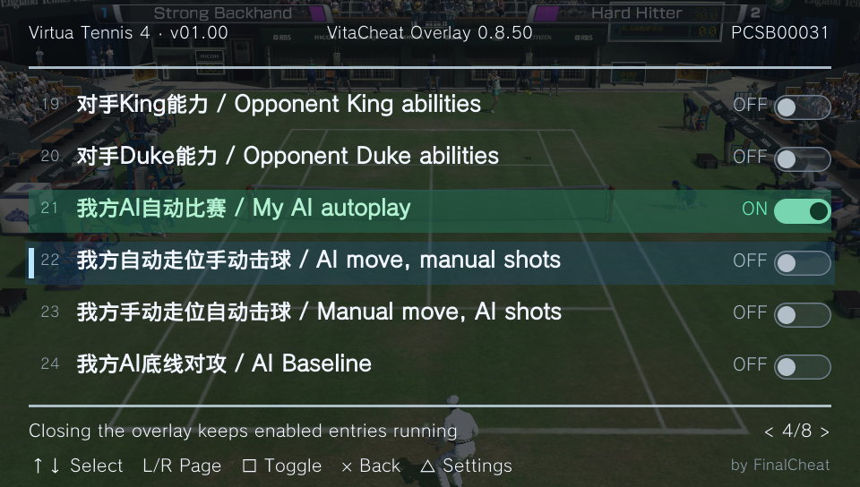

# VitaCheat Overlay

[](https://github.com/Finalcheat/vitacheat-overlay/actions/workflows/ci.yml)
[](LICENSE)

[English](README.md) · [简体中文](README.zh-CN.md)

A full-screen PS Vita cheat-list overlay with controller navigation, multilingual menus, and direct execution of VitaCheat `.psv` files.

**by FinalCheat** · [Downloads](https://github.com/Finalcheat/vitacheat-overlay/releases) · [MIT License](LICENSE)

VitaCheat Overlay is an independent implementation. It uses VitaCheat's existing database directory and code format; the original VitaCheat plugin is not required.



## Features

- Full-screen 960 × 544 interface with game name, installed version, Title ID, pagination, and capsule switches.
- Clear selection highlighting and distinct colors for enabled entries.
- Direct `.psv` loading from `ux0:vitacheat/db`, with UTF-8 and GBK support.
- English, Simplified Chinese, Traditional Chinese, Japanese, Korean, and **Follow system** menus.
- Configurable opening shortcut, persistent settings, and 0–100% panel opacity (70% default, 5% steps).
- Asian and Western confirm/back conventions, with Square always used to toggle cheats.
- Support for the documented public VitaCheat code families: direct writes, pointers, compressed writes, copies, instruction patches, module-relative addressing, button conditions, and comparisons.

The plugin provides list browsing and cheat execution. It does not include memory searching, a code editor, or hardware breakpoints. Menus use controller input.

## Installation

You need a PS Vita configured to load taiHEN plugins and a `.psv` list matching the game's Title ID and version.

1. Download `VitaCheatOverlay-<version>.zip` from [Releases](https://github.com/Finalcheat/vitacheat-overlay/releases). GitHub's automatically generated **Source code** archives are for building, not installation.
2. Close running games. Extract the package and copy these files from `ux0/vitacheat/` to `ux0:vitacheat/` on the Vita:

   ```text
   VitaCheatOverlayKernel.skprx
   VitaCheatOverlayShell.suprx
   VitaCheatOverlayUI.suprx
   VitaCheatOverlayGame.suprx
   vco-base.rco
   ```

3. Back up the active taiHEN configuration and add the following paths to its existing sections:

   ```ini
   *KERNEL
   ux0:vitacheat/VitaCheatOverlayKernel.skprx

   *main
   ux0:vitacheat/VitaCheatOverlayShell.suprx
   ```

   Only Kernel and Shell need configuration. They load the UI and game plugin automatically. Preserve other plugin entries; do not register UI or Game under `*main` or `*ALL`.

4. Put each game's list at `ux0:vitacheat/db/<TITLE_ID>.psv`.
5. Fully restart the Vita, start a game, and press **L + SELECT**.

The UI can also open in LiveArea, but executing cheats requires a game session. Settings are saved to `ux0:vitacheat/vco-settings.ini`. Database files are not rewritten.

The original VitaCheat can remain installed. When comparing the two plugins, enable an entry in one plugin at a time to avoid conflicting writes or patches.

## Controls

| Action | Default control |
| --- | --- |
| Open overlay | L + SELECT; configurable |
| Select entry or setting | D-pad ↑ / ↓ |
| Previous / next page | L / R |
| Toggle selected cheat | **□ Square** |
| Open settings | △ Triangle |
| Adjust setting | D-pad ← / → |
| Confirm settings | ○ Circle; × Cross in Western mode |
| Back / close | × Cross; ○ Circle in Western mode |

Language and opacity changes are previewed in settings. **Apply settings** saves the draft after the buttons are released. **Restore defaults** changes the draft and still requires Apply. **Reload list** refreshes the file and leaves every entry OFF. Only the opening shortcut is freely remappable.

## Cheat behavior

- All entries start **OFF** in a new game session, including `_V1` entries. Enabled states are not replayed when a game is reopened.
- Turning a normal data entry OFF stops future writes; it does not restore an earlier score, health value, or other game data.
- Turning an A-family patch OFF restores its saved original bytes. B-family codes supply module-relative addressing and can be combined with A patches.
- Closing the overlay leaves enabled cheats active. Module/session changes can stop execution and reset the list.
- Invalid codes, addresses, pointers, version declarations, or patch conflicts produce an error detail. Codes must match the installed game build.

See [Code formats](docs/CODE_FORMATS.md) and the [official VitaCheat documentation](https://finalcheat.github.io/) for further details.

## Updates and removal

To update, completely close games, replace the five plugin/resource files, and fully restart. Preserve `db/` and the settings file. Consult the release notes for any settings migration or downgrade instructions.

To uninstall, remove the two VCO configuration entries and fully restart before deleting its files. Keep the database and original VitaCheat files. VCO settings and `vco-*.log` files can be removed separately.

## Troubleshooting

| Symptom | Check |
| --- | --- |
| Overlay does not open | Active config, both required entries, all five files, full reboot, and opening shortcut |
| Missing list or incorrect text | Title ID filename, DB path, encoding selection, and displayed error |
| Entry fails when enabled | Game version, error detail/code line, current addresses, and another plugin's patch state |
| Settings fail after a downgrade | Restore settings from the older version or remove `vco-settings.ini` to use defaults |

For a bug report, include the plugin version, game Title ID/version, relevant code entry, error detail, and reproduction steps.

## Development

Build instructions are in [Building](docs/BUILDING.md). See [Architecture](docs/ARCHITECTURE.md), [Contributing](CONTRIBUTING.md), and [Release procedure](docs/RELEASING.md) for development and maintenance.

## License and credits

Project-authored code is available under the [MIT License](LICENSE). Third-party materials retain their own licenses; see [Third-party notices](THIRD_PARTY_NOTICES.md).

Created **by FinalCheat**. Thanks to VitaSDK, taiHEN, GrapheneCt's PAF research and PSVshellPlus resource work, and the Unicode mapping maintainers.
