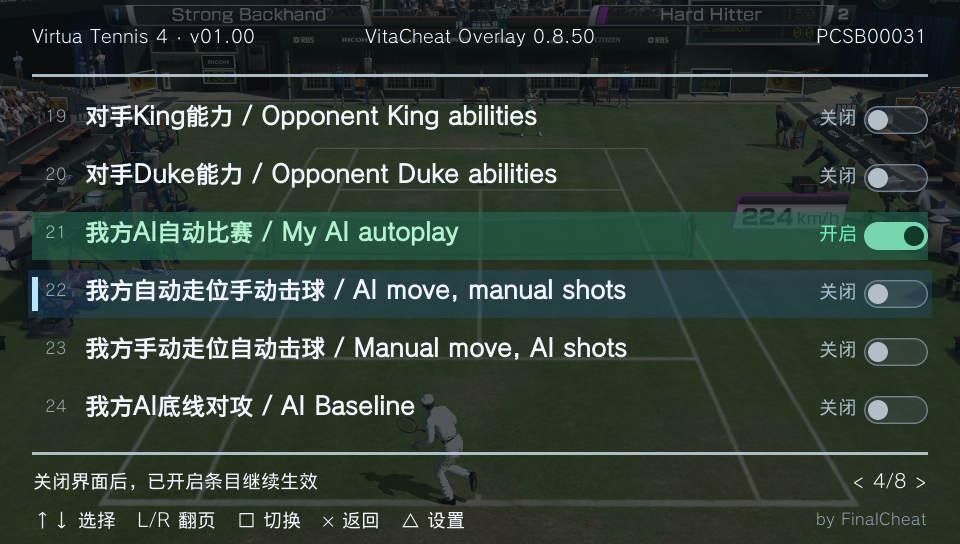

# VitaCheat Overlay

[](https://github.com/Finalcheat/vitacheat-overlay/actions/workflows/ci.yml)
[](LICENSE)

[English](README.md) · [简体中文](README.zh-CN.md)

面向 PS Vita 的全屏金手指列表界面，支持按键操作、多语言菜单，以及直接读取执行 VitaCheat `.psv` 文件。

**by FinalCheat** · [下载](https://github.com/Finalcheat/vitacheat-overlay/releases) · [MIT 许可证](LICENSE)

本项目为独立实现，共用 VitaCheat 的数据库目录和代码格式，不依赖原版 VitaCheat 插件。



## 功能

- 960 × 544 全屏界面，显示游戏名称、已安装版本、游戏编号、分页和胶囊开关。
- 清晰的当前位置标记，以及区分开启状态的行颜色。
- 从 `ux0:vitacheat/db` 直接读取 `.psv`，支持 UTF-8 与 GBK。
- 支持英文、简体中文、繁体中文、日文、韩文及“跟随系统”。
- 支持呼出组合键配置、设置保存、0–100% 面板不透明度（默认 70%，每档 5%）。
- 支持亚洲／欧美确认返回习惯，修改项始终使用方块切换。
- 支持公开文档中的 VitaCheat 代码家族：直接写入、指针、压缩写入、内存复制、指令补丁、模块相对寻址、按键条件及数值比较。

插件专注于列表显示和代码执行，不包含内存搜索、代码编辑或硬件断点。菜单仅使用按键操作。

## 安装

需要已配置 taiHEN 的 PS Vita，以及与游戏编号和版本匹配的 `.psv` 文件。

1. 从 [Releases](https://github.com/Finalcheat/vitacheat-overlay/releases) 下载 `VitaCheatOverlay-<版本>.zip`。GitHub 自动生成的 **Source code** 压缩包用于源码构建，不是安装包。
2. 完全关闭游戏，解压安装包，将 `ux0/vitacheat/` 中的以下文件复制到设备的 `ux0:vitacheat/`：

   ```text
   VitaCheatOverlayKernel.skprx
   VitaCheatOverlayShell.suprx
   VitaCheatOverlayUI.suprx
   VitaCheatOverlayGame.suprx
   vco-base.rco
   ```

3. 备份实际生效的 taiHEN 配置，在现有分组下加入：

   ```ini
   *KERNEL
   ux0:vitacheat/VitaCheatOverlayKernel.skprx

   *main
   ux0:vitacheat/VitaCheatOverlayShell.suprx
   ```

   仅配置 Kernel 和 Shell；它们会自动加载 UI 和游戏插件。保留其他插件，不要将 UI 或 Game 加入 `*main` 或 `*ALL`。

4. 将各游戏代码文件放到 `ux0:vitacheat/db/<游戏编号>.psv`。
5. 完整重启，进入游戏后按 **L + SELECT** 呼出。

界面在 LiveArea 中也能呼出，但执行修改需要游戏会话。设置保存在 `ux0:vitacheat/vco-settings.ini`，插件不会改写数据库文件。

可以保留原版 VitaCheat 进行对照，但同一修改项应分别在两套插件中开启，避免同时写入或补丁冲突。

## 默认操作

| 操作 | 按键 |
| --- | --- |
| 呼出界面 | L + SELECT，可配置 |
| 选择条目／设置 | 方向键 ↑／↓ |
| 上一页／下一页 | L／R |
| 开启／关闭修改项 | **□ 方块** |
| 打开设置 | △ 三角 |
| 调整设置 | 方向键 ←／→ |
| 设置确认 | 默认 ○ 圈；欧美模式为 × 叉 |
| 返回／关闭 | 默认 × 叉；欧美模式为 ○ 圈 |

语言和不透明度可在设置中预览。“应用设置”在松开按键后保存草稿。“恢复默认设置”仅修改草稿，仍需应用。“重新加载列表”用于刷新代码文件，载入后所有条目关闭。只有呼出组合键可自由配置。

## 执行规则

- 新游戏会话的所有条目均为**关闭**，包括 `_V1` 条目。重新进入游戏不会恢复开启状态。
- 关闭普通数据修改项只停止后续写入，不恢复此前的比分、血量等游戏数值。
- 关闭 A 类补丁时恢复保存的原始字节；B 类负责模块相对寻址，可与 A 补丁组合使用。
- 收起界面不会关闭已开启条目。模块或会话变化可能停止执行并重置列表。
- 代码、地址、指针、版本声明或补丁冲突会显示错误详情。代码必须匹配已安装的游戏版本。

详细说明见[代码格式](docs/CODE_FORMATS.md)及 [VitaCheat 官方文档](https://finalcheat.github.io/)。

## 更新与卸载

更新时，完全关闭游戏，替换五个插件／资源文件后完整重启。保留 `db/` 和设置文件；设置迁移或降级要求请查看版本说明。

卸载时，删除两条 VCO 配置路径并完整重启，再删除插件文件。保留数据库和原版 VitaCheat 文件；VCO 设置及 `vco-*.log` 可单独清理。

## 常见问题

| 现象 | 检查内容 |
| --- | --- |
| 无法呼出 | 生效配置、两条加载路径、五个文件、完整重启及组合键 |
| 无列表或乱码 | 游戏编号文件名、数据库目录、编码设置和界面错误 |
| 开启失败 | 游戏版本、错误详情／代码行、当前地址及其他插件补丁状态 |
| 降级后设置异常 | 恢复旧版设置，或删除 `vco-settings.ini` 使用默认设置 |

反馈问题时，请提供插件版本、游戏编号／版本、相关代码条目、错误详情和复现步骤。

## 开发

构建步骤见[构建说明](docs/BUILDING.md)。架构与维护流程见[架构](docs/ARCHITECTURE.md)、[贡献指南](CONTRIBUTING.md)和[发布流程](docs/RELEASING.md)。

## 许可与致谢

项目原创代码采用 [MIT 许可证](LICENSE)。第三方材料保留各自许可，详见[第三方声明](THIRD_PARTY_NOTICES.md)。

本项目制作署名为 **by FinalCheat**。感谢 VitaSDK、taiHEN、GrapheneCt 的 PAF 研究与 PSVshellPlus 资源，以及 Unicode 映射维护者。
