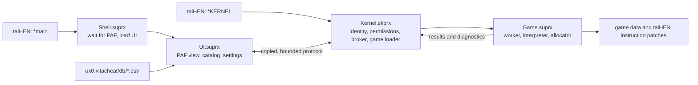

# Architecture

VitaCheat Overlay separates rendering and storage from game execution. The resident kernel component brokers validated requests; the interpreter and its working memory live in the target game process.

## Responsibilities

| Component | Responsibilities | Lifetime |
| --- | --- | --- |
| Kernel | Authorized Shell/game callers, session identity, copied message broker, game loading, permission checks, public module boundaries | Resident after boot |
| Shell loader | Wait for the Shell PAF module; load UI from the shared directory | Shell process |
| UI | Render through the Shell PAF callback; manage catalog, settings, input, and command/results state | Shell process |
| Game | Compile uploaded code, run periodic updates, own execution buffers, apply and restore user-mode taiHEN patches | Target game process |

The UI does not execute `.psv` instructions in its rendering callback. Separate services perform file work and communicate through snapshots. The portable code core receives memory, module, pad, and patch callbacks instead of directly dereferencing game addresses.

## Data flow

1. Resolve a candidate game's identity and validate it through the kernel.
2. Read `db/<TITLE_ID>.psv`, decode UTF-8/GBK, and parse a bounded list. Read installed title/version metadata for the header and version checks.
3. Upload copied data using the private agent protocol; bind the resulting list to the current session. All desired entry states start OFF.
4. A Square press submits an entry change. Game processes it and publishes an acknowledged result; UI displays pending, enabled, disabled, or failure state.
5. While execution is active, the game worker applies a bounded update approximately every 50 ms. Scheduling is not a real-time guarantee.

The contract is defined by `src/agent/protocol.h`, `src/execution/service_protocol.h`, and the exported syscall declarations. The raw ARM syscall interface is deliberately limited to arguments fitting r0–r3; larger messages are copied through validated pointers.

## Ownership and cleanup

- Ordinary writes have no value rollback. Instruction patches retain the original bytes and restore them when disabled.
- Patch claims prevent one VCO entry from restoring another VCO entry's overlapping patch. They cannot synchronize a separate cheat plugin's ownership.
- Foreground/session changes invalidate authority before further work. Public module transitions stop affected execution and rebind to an all-OFF session.
- Game allocation and execution threads belong to the target process. Normal process termination uses that process lifetime and taiHEN's target-PID cleanup, rather than a universal private firmware destructor hook.
- Failed restore, stop, free, or publication operations are handled explicitly. Host tests model these errors; actual firmware behavior still requires device validation.

The current normal kernel target uses `src/agent/native_*` and the shared Shell owner helper. Historical `src/platform/vita` execution adapters remain for regression coverage and optional SDK probes; they are not the normal game interpreter. Do not wire those adapters back into the production target without a separate design review.

## Capacity and performance boundaries

`src/execution/limits.h` and the upload/catalog contracts define admission and work limits. The current engine admits up to 256 entries, 8,192 physical code lines, and 16 simultaneously active entries; patch-claim storage and each entry's work budget impose additional limits. A large compressed repeat count does not automatically increase its budget.

The UI uses the system PAF, so fonts, widget allocations, and decoded textures are outside the simple static segment model. `scripts/resource_budget.py` produces an allocation model; the optional resource profile collects bounded diagnostic observations. Neither by itself proves total RAM use, zero leaks, frame-rate cost, or universal module-lifetime safety.
